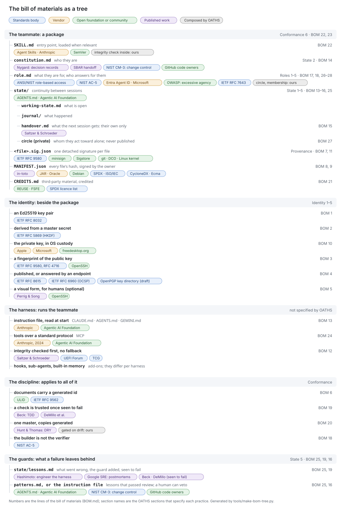

# Bill of materials

Each line is a practice, the prior art it comes from, and the OATHS section that specifies it. Every source was checked against its primary text on 2026-09-29; a line added later names the date it was checked. Where OATHS composes known practice into something of its own, the line says so instead of citing it as prior art.

## The bill of materials as a tree

Where each practice sits in an AI teammate, with the body it comes from. The numbers are the lines below; the section names are the OATHS sections that specify them.



The same tree as text:

```
the teammate (a package)                Conformance 6 · BOM 22, 23
│                                       Agent Skills (Anthropic, open standard) · SemVer
├── SKILL.md                            entry point, loaded when relevant
│                                       ▸ Agent Skills format: Anthropic (BOM 22)
│                                       ▸ read by Claude, Codex, ChatGPT, Gemini CLI,
│                                         Grok Build, Mistral Vibe, OpenClaw
├── constitution.md                     who they are                  State 2 · BOM 14
│                                       ▸ Nygard (decision records) · SBAR handoff
├── role.md                             what they are for, who answers   Roles 1–5 · BOM 17, 18, 26–28
│                                       ▸ ANSI/NIST role-based access · NIST separation of duties
│                                       ▸ Entra Agent ID (sponsors) · OWASP LLM06 · IETF RFC 7643
├── state/                              continuity                   State 1–5 · BOM 13–16, 25
│   ├── working-state.md                what is open
│   ├── journal/                        what happened
│   ├── handover.md                     what the next session gets: their own only
│   │                                   ▸ Saltzer & Schroeder (least privilege)
│   └── circle (private)                whom they act toward alone; never published   BOM 27
├── <file>.sig.json                     one detached signature per file   Provenance · BOM 7, 11
│                                       ▸ IETF OpenPGP (RFC 9580) · minisign · Sigstore
│                                       ▸ git, Developer Certificate of Origin, Linux kernel
├── MANIFEST.json (+ its signature)     every file's hash, signed by the owner   BOM 8, 9
│                                       ▸ JAR (Oracle) · Debian · in-toto · SPDX · CycloneDX
└── CREDITS.md                          third-party material         Conformance · BOM 21
                                        ▸ FSFE REUSE · SPDX licence list

the identity (beside the package)       Identity 1–5
├── an Ed25519 key pair                 ▸ IETF RFC 8032                         BOM 1
├── derived from a master secret        ▸ IETF RFC 5869 (HKDF)                  BOM 2
├── the private key, in OS custody      ▸ Apple · freedesktop.org · Microsoft   BOM 10
├── a fingerprint of the public key     ▸ IETF OpenPGP, SSH · OpenSSH           BOM 3
├── published, or answered by an endpoint                                       BOM 4
│                                       ▸ IETF RFC 8615, 6960 · OpenPGP key directory
└── a visual form, for humans (optional) ▸ Perrig & Song · OpenSSH              BOM 5

the harness (runs the teammate; OATHS does not specify it)   see [harnesses](spec/harnesses.md)
├── instruction file, read at start     CLAUDE.md · AGENTS.md · GEMINI.md       BOM 13
│                                       ▸ Anthropic · Agentic AI Foundation (Linux Foundation)
├── tools over a standard protocol      MCP                                     BOM 24
│                                       ▸ introduced by Anthropic, 2024; now Agentic AI Foundation
├── integrity checked first, no fallback                                        BOM 12
│                                       ▸ Saltzer & Schroeder · UEFI · TCG
└── hooks, sub-agents, built-in memory  add-ons, differ per harness

the discipline (applies to all of this)   Conformance
├── documents carry a generated id      ▸ ULID · IETF RFC 9562                  BOM 6
├── a check is trusted once seen to fail ▸ Beck (TDD) · DeMillo et al.          BOM 19
├── one master, copies generated        ▸ Hunt & Thomas (DRY)                   BOM 20
│                                       ▸ "gated on drift" is OATHS's own composition
└── the builder is not the verifier     ▸ NIST AC-5                            BOM 18

the guards (what a failure leaves behind)  State 5 · BOM 25
├── state/lessons.md                    what went wrong, the guard added, seen to fail   BOM 25, 19
│                                       ▸ Hashimoto (engineer the harness) · Google SRE (postmortems)
└── patterns.md, or the instruction file   lessons that passed review; a human can veto  BOM 25, 16
                                        ▸ AGENTS.md · NIST CM-3 (change control) · GitHub code owners
```

### By the body behind each source

| Kind of body | Sources (BOM lines) |
|---|---|
| Standards bodies | IETF: RFC 8032 (1), 5869 (2), 9580 and 4716 (3, 7), 8615 and 6960 (4), 9562 (6), 7643 (28) · ISO/IEC: SPDX (9) · Ecma: CycloneDX (9) · ANSI/INCITS and NIST: RBAC (17), CM-3 (16), AC-5 (18) · UEFI Forum, TCG (12) |
| Vendors | Anthropic: CLAUDE.md (13), Agent Skills (22), MCP (24) · Apple (10) · Microsoft (10, 26) · Oracle (8) |
| Open foundations and communities | Agentic AI Foundation, Linux Foundation: AGENTS.md (13), MCP (24) · OpenSSH (3, 5) · Debian (8) · FSFE (21) · freedesktop.org (10) · Open Container Initiative (22) · Sigstore, minisign (7) · GitHub code owners (16) · git, Linux kernel, Developer Certificate of Origin (11) · ULID (6) · SemVer (23) · OWASP (27) |
| Published works | Hashimoto (25) · Google SRE book (25) · Saltzer & Schroeder (12, 15) · Perrig & Song (5) · Nygard, SBAR (14) · Beck, DeMillo et al. (19) · Hunt & Thomas (20) · in-toto (8) |
| Composed by OATHS | "gated on drift" (20) · the teammate owning their own memory (16) · the integrity check bundled in the package (22) · the sponsor named where the role is assigned (26) · the circle, kept private (27) · cohort membership on both sides (28) |

The harnesses that already carry these mechanisms, and the evidence, are in [harnesses](spec/harnesses.md).

## The lines

<a id="bom-1"></a>

### 1 · A teammate has their own asymmetric signing key

- **Prior art:** Josefsson & Liusvaara, RFC 8032, *Edwards-Curve Digital Signature Algorithm (EdDSA)*, 2017. rfc-editor.org/rfc/rfc8032
- **Section:** [identity](spec/identity.md)
- **Source checked:** verified

<a id="bom-2"></a>

### 2 · Keys are derived from a master secret, not stored one per teammate

- **Prior art:** Krawczyk & Eronen, RFC 5869, *HMAC-based Extract-and-Expand Key Derivation Function (HKDF)*, 2010. rfc-editor.org/rfc/rfc5869
- **Section:** [identity](spec/identity.md)
- **Source checked:** verified

<a id="bom-3"></a>

### 3 · A short fingerprint of the public key names the teammate

- **Prior art:** RFC 9580, *OpenPGP*, 2024, §5.5.4.3, the version 6 key fingerprint, a SHA2-256 hash of the key (§5.5.4.2 is the older version 4 form, SHA-1; RFC 9580 obsoletes RFC 4880). RFC 4716, *The Secure Shell (SSH) Public Key File Format*, 2006, §4, names the fingerprint idea (MD5); the SHA256 form is OpenSSH practice since 6.8 (2015). rfc-editor.org/rfc/rfc9580 · rfc-editor.org/rfc/rfc4716
- **Section:** [identity](spec/identity.md)
- **Source checked:** verified

<a id="bom-4"></a>

### 4 · Public keys are published at a well-known address, or answered for by a verification endpoint, that anyone can check

- **Prior art:** Nottingham, RFC 8615, *Well-Known Uniform Resource Identifiers (URIs)*, 2019. OpenPGP Web Key Directory, draft-koch-openpgp-webkey-service (an Internet-Draft, work in progress). For the endpoint: Santesson et al., RFC 6960, *X.509 Internet Public Key Infrastructure Online Certificate Status Protocol - OCSP*, 2013: a client asks an online responder about one identified certificate and gets a signed answer, without needing a published list (abstract, §2, §2.2). rfc-editor.org/rfc/rfc8615 · datatracker.ietf.org/doc/draft-koch-openpgp-webkey-service/ · rfc-editor.org/rfc/rfc6960
- **Section:** [identity](spec/identity.md)
- **Source checked:** verified; RFC 6960 checked against its text on 2026-10-12 (the abstract, §2 and §2.2)

<a id="bom-5"></a>

### 5 · A fingerprint can be shown visually for humans

- **Prior art:** Perrig & Song, *Hash Visualization*, 1999 (cited by OpenSSH 5.1's visual host key, 2008). openssh.org/txt/release-5.1
- **Section:** [identity](spec/identity.md)
- **Source checked:** verified

<a id="bom-6"></a>

### 6 · Documents carry a stable generated id, not a path

- **Prior art:** ULID specification, github.com/ulid/spec. RFC 9562, *Universally Unique IDentifiers (UUIDs)*, 2024 (obsoletes RFC 4122). rfc-editor.org/rfc/rfc9562
- **Section:** [conformance](spec/conformance.md)
- **Source checked:** verified

<a id="bom-7"></a>

### 7 · Files are signed by a detached signature beside them

- **Prior art:** RFC 9580 §10.4, *Detached Signatures*. minisign (jedisct1.github.io/minisign). Sigstore cosign (docs.sigstore.dev/cosign/signing/overview/)
- **Section:** [provenance](spec/provenance.md)
- **Source checked:** verified

<a id="bom-8"></a>

### 8 · A package carries a signed manifest of every file

- **Prior art:** Oracle, *JAR File Specification*: Manifest, Signed JAR File. Debian Repository Format: Release, InRelease (wiki.debian.org/DebianRepository/Format). Torres-Arias et al., *in-toto*, USENIX Security 2019; in-toto specification 1.0
- **Section:** [provenance](spec/provenance.md)
- **Source checked:** verified

<a id="bom-9"></a>

### 9 · A package declares its materials

- **Prior art:** ISO/IEC 5962:2021, *SPDX Specification V2.2.1*. CycloneDX, ECMA-424 (1st edition 2024, CycloneDX 1.6; 2nd edition December 2025, CycloneDX 1.7). iso.org/standard/81870.html · ecma-international.org
- **Section:** [provenance](spec/provenance.md)
- **Source checked:** verified

<a id="bom-10"></a>

### 10 · Private keys stay in OS custody, never on disk

- **Prior art:** Apple, *Keychain Services*. freedesktop.org, *Secret Service API* (still a draft). Microsoft, `CryptProtectData` (DPAPI)
- **Section:** [provenance](spec/provenance.md)
- **Source checked:** verified

<a id="bom-11"></a>

### 11 · A seal claims authorship; an edit does not; the owner reviews a seal in their name

- **Prior art:** git-commit(1), author and committer. Developer Certificate of Origin 1.1 (developercertificate.org). Linux kernel, *Submitting patches*: Signed-off-by, Reviewed-by (docs.kernel.org/process/submitting-patches.html)
- **Section:** [provenance](spec/provenance.md)
- **Source checked:** verified

<a id="bom-12"></a>

### 12 · Integrity is checked first at session start; failure stops, never falls back

- **Prior art:** Saltzer & Schroeder, *The Protection of Information in Computer Systems*, Proc. IEEE 63(9), 1975, §I.A.3 principle (b), fail-safe defaults: base access on permission, so a failure denies rather than grants; OATHS applies it to the start of a session. UEFI Specification, chapter 32, *Secure Boot and Driver Signing*. TCG PC Client Platform Firmware Profile (measured boot)
- **Section:** [conformance](spec/conformance.md)
- **Source checked:** verified (Saltzer & Schroeder's principle is about access decisions; the session-start reading is OATHS's application of it)

<a id="bom-13"></a>

### 13 · A teammate's state lives in plain, versioned files they read at start

- **Prior art:** AGENTS.md (agents.md; Agentic AI Foundation, Linux Foundation). Anthropic, CLAUDE.md, *How Claude remembers your project* (code.claude.com/docs/en/memory)
- **Section:** [state](spec/state.md)
- **Source checked:** verified

<a id="bom-14"></a>

### 14 · State is layered: constitution, working state, journal, handover

- **Prior art:** Nygard, *Documenting Architecture Decisions*, 2011 (cognitect.com). SBAR handoff: Leonard, Graham, Bonacum, Qual Saf Health Care 2004;13(Suppl 1):i85–i90 (IHI)
- **Section:** [state](spec/state.md)
- **Source checked:** citation verified; the 2004 paper not read in full, and the fit is loose: the five-slot layering is OATHS's own composition

<a id="bom-15"></a>

### 15 · A session receives only its own handover

- **Prior art:** Saltzer & Schroeder 1975, §I.A.3 principle (f): least privilege
- **Section:** [state](spec/state.md)
- **Source checked:** verified

<a id="bom-16"></a>

### 16 · Memory is the teammate's own; changes to files that fix their identity or strategy are reviewable and can be vetoed

- **Prior art:** NIST SP 800-53 Rev. 5, CM-3 *Configuration Change Control*: review proposed changes and approve or disapprove them, and monitor and review the activity over time (csrc.nist.gov). GitHub, *About code owners*: a change to a protected file needs the owner's approval before it merges (docs.github.com). The teammate owning their own memory is OATHS's own composition
- **Section:** [state](spec/state.md)
- **Source checked:** verified for CM-3 and code owners (GitHub's approval applies where "Require review from Code Owners" is on); memory ownership and periodic re-review are OATHS's own

<a id="bom-17"></a>

### 17 · Each teammate holds a defined role, readable as a file

- **Prior art:** ANSI INCITS 359-2004, *Role-Based Access Control* (revised INCITS 359-2012); csrc.nist.gov/projects/role-based-access-control
- **Section:** [roles](spec/roles.md)
- **Source checked:** verified

<a id="bom-18"></a>

### 18 · The one who builds is not the one who verifies

- **Prior art:** NIST SP 800-53 Rev. 5, AC-5 *Separation of Duties* (csrc.nist.gov)
- **Section:** [roles](spec/roles.md)
- **Source checked:** verified

<a id="bom-19"></a>

### 19 · A check is trusted only once it has been seen to fail

- **Prior art:** Beck, *Test-Driven Development: By Example*, Addison-Wesley, 2002 (red/green/refactor). DeMillo, Lipton, Sayward, *Hints on Test Data Selection*, Computer 11(4), 1978 (mutation testing)
- **Section:** [conformance](spec/conformance.md)
- **Source checked:** verified

<a id="bom-20"></a>

### 20 · One master; any copy is generated and gated on drift

- **Prior art:** Hunt & Thomas, *The Pragmatic Programmer*, 1999: DRY, "every piece of knowledge must have a single, unambiguous, authoritative representation within a system" (media.pragprog.com/titles/tpp20/dry.pdf). *Gated on drift* is OATHS's own composition: DRY plus a check that a generated copy still matches its master
- **Section:** [conformance](spec/conformance.md)
- **Source checked:** verified (the drift gate is ours, not prior art)

<a id="bom-21"></a>

### 21 · Third-party material is credited in one checked file

- **Prior art:** FSFE, *REUSE Specification 3.3*, 2024 (reuse.software). SPDX License List (spdx.org/licenses)
- **Section:** [conformance](spec/conformance.md)
- **Source checked:** verified

<a id="bom-22"></a>

### 22 · A package is self-contained, with its integrity check inside

- **Prior art:** for a self-contained package: Agent Skills *Specification* (agentskills.io/specification), a folder that bundles its scripts and references; *OCI Image Manifest Specification*, content addressed by digest (github.com/opencontainers/image-spec). Carrying the integrity check inside the package is OATHS's own composition
- **Section:** packaging (see [conformance](spec/conformance.md) 6)
- **Source checked:** verified (the bundled integrity check is ours, not prior art)

<a id="bom-23"></a>

### 23 · Versions carry meaning

- **Prior art:** Preston-Werner, *Semantic Versioning 2.0.0* (semver.org)
- **Section:** packaging (see [conformance](spec/conformance.md) 6)
- **Source checked:** verified

<a id="bom-24"></a>

### 24 · The harness exposes tools to the model over a standard protocol

- **Prior art:** *Model Context Protocol* (modelcontextprotocol.io); introduced by Anthropic, 2024; now with the Agentic AI Foundation
- **Section:** harness (see [harnesses](spec/harnesses.md))
- **Source checked:** verified

<a id="bom-25"></a>

### 25 · Every failure leaves a guard: a recorded lesson, and a change to the harness that prevents its return

- **Prior art:** Hashimoto, *My AI Adoption Journey*, February 2026, the step "Engineer the harness": each time an agent makes a mistake, engineer a solution so it never makes that mistake again, as a line in the instruction file or a tool that verifies the behaviour (mitchellh.com/writing/my-ai-adoption-journey). Beyer, Jones, Petoff, Murphy (eds.), *Site Reliability Engineering*, O'Reilly, 2016, chapter 15, *Postmortem Culture: Learning from Failure*: a written record of the incident, its causes, and the follow-up actions that prevent recurrence (sre.google/sre-book/postmortem-culture/). That a guard is trusted once seen to fail is [BOM 19](BOM.md#bom-19)
- **Section:** [state](spec/state.md)
- **Source checked:** verified (both pages read; the "lessons" slot and its three parts are OATHS's own composition of the two)

<a id="bom-26"></a>

### 26 · A teammate has a sponsor: a person who answers for them and can end their standing

- **Prior art:** Microsoft, *Administrative relationships in Microsoft Entra Agent ID (Owners, sponsors, and managers)*, Microsoft Learn (dated 2026-04-16, updated 2026-09-03): sponsors are accountable for an agent's purpose and lifecycle, at least one is required for each agent identity, a sponsor is a user or a group, can disable the agent, and is distinct from an owner (technical administration) and a manager. learn.microsoft.com/en-us/entra/agent-id/agent-owners-sponsors-managers
- **Section:** [roles](spec/roles.md)
- **Source checked:** verified 2026-10-12 (the page read; it allows users and groups as sponsors, where an owner may also be a service principal). That a sponsor is never a teammate, that they are named where the role is assigned, and that their own yes is recorded are OATHS's own composition

<a id="bom-27"></a>

### 27 · Toward anyone outside their circle, a teammate drafts and a person decides

- **Prior art:** OWASP Top 10 for LLM Applications 2025, LLM06:2025 *Excessive Agency*: mitigation 6, human-in-the-loop approval of high-impact actions, and the mail example, where the user reviews and sends every drafted mail (genai.owasp.org/llmrisk/llm062025-excessive-agency/)
- **Section:** [roles](spec/roles.md)
- **Source checked:** verified 2026-10-12 (the page read). The circle, the people toward whom a teammate may act without that review, and the rule that it is never published, in part or as a hash, are OATHS's own composition

<a id="bom-28"></a>

### 28 · A cohort is a named set of teammates whose members are recorded

- **Prior art:** Hunt et al., RFC 7643, *System for Cross-domain Identity Management: Core Schema*, 2015, §4.2: the Group resource and its `members`. rfc-editor.org/rfc/rfc7643
- **Section:** [roles](spec/roles.md)
- **Source checked:** verified 2026-10-12 (§4.2 read). That membership needs both sides, the cohort's record and the member's own state, and is never inferred from who made a teammate, is OATHS's own composition
