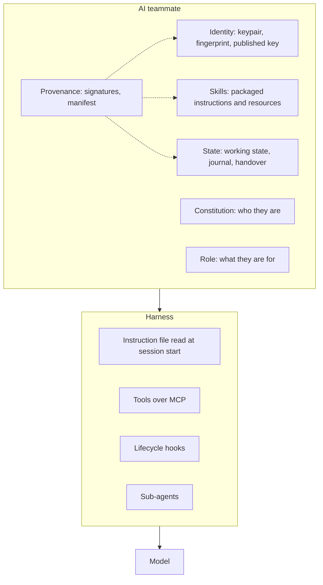

# Anatomy of an AI teammate

> [!note] Version 1.0.0
> Every ingredient names the OATHS section that specifies it and the bill-of-materials lines its practice comes from. The harness line says where existing harnesses already carry the ingredient; details and sources are in [harnesses](harnesses.md).

> [!abstract]- The diagram as text
> - The **AI teammate** holds identity, constitution, role, state, skills and provenance.
> - They run on a **harness**, which supplies an instruction file read at session start, tools over MCP, lifecycle hooks and sub-agents.
> - The harness runs the **model**.
> - Provenance (signatures and a manifest) checks identity, skills and state.

## The ingredients

### Model

- **What it is:** the language model that reasons
- **OATHS:** not specified
- **Prior art:** —
- **Where harnesses carry it:** every harness

### Harness

- **What it is:** the program that runs the model, loads context and executes tools
- **OATHS:** not specified
- **Prior art:** —
- **Where harnesses carry it:** see [harnesses](harnesses.md)

### Instruction file

- **What it is:** plain text the harness reads at every session start
- **OATHS:** State 1
- **Prior art:** [BOM 13](../BOM.md#bom-13)
- **Where harnesses carry it:** `CLAUDE.md`, `AGENTS.md`, `GEMINI.md`, project instructions

### Constitution

- **What it is:** who the teammate is: their values and their limits
- **OATHS:** State 2
- **Prior art:** [BOM 14](../BOM.md#bom-14)
- **Where harnesses carry it:** carried as, or loaded from, the instruction file

### Role

- **What it is:** what the teammate is for, where their authority ends, who answers for them (a sponsor), whom they may act toward alone (a circle, kept private) and the cohort they were sent out with, if any
- **OATHS:** Roles 1–5
- **Prior art:** [BOM 17](../BOM.md#bom-17), [BOM 18](../BOM.md#bom-18), [BOM 26](../BOM.md#bom-26)–[BOM 28](../BOM.md#bom-28)
- **Where harnesses carry it:** no harness defines it; OATHS adds it as a file

### State

- **What it is:** working state, journal, handover: continuity between sessions
- **OATHS:** State 1–4
- **Prior art:** [BOM 13](../BOM.md#bom-13)–[BOM 16](../BOM.md#bom-16)
- **Where harnesses carry it:** built-in memory differs per harness; OATHS keeps it in plain files so it travels

### Lessons

- **What it is:** what went wrong, and the guard now in place, so the same failure does not return
- **OATHS:** State 5
- **Prior art:** [BOM 25](../BOM.md#bom-25)
- **Where harnesses carry it:** as the growing rule list in the instruction file (`AGENTS.md`, `CLAUDE.md`, `GEMINI.md`) and as custom checks and tools; no harness has a slot for the record itself
- **Promoted patterns:** lessons that pass review become patterns: rules in the instruction file, or a `patterns.md` it names

### Skills

- **What it is:** packaged instructions and resources, loaded when needed
- **OATHS:** Conformance 6
- **Prior art:** [BOM 22](../BOM.md#bom-22)
- **Where harnesses carry it:** Agent Skills `SKILL.md` in Claude, Codex, ChatGPT, Gemini CLI, Grok Build, Mistral Vibe, OpenClaw

### Tools

- **What it is:** actions exposed to the model over a standard protocol
- **OATHS:** Conformance 7
- **Prior art:** [BOM 24](../BOM.md#bom-24)
- **Where harnesses carry it:** MCP client in every harness listed

### Identity

- **What it is:** a keypair and fingerprint a stranger can check
- **OATHS:** Identity 1–5
- **Prior art:** [BOM 1](../BOM.md#bom-1)–[BOM 5](../BOM.md#bom-5)
- **Where harnesses carry it:** no harness defines it; OATHS adds it

### Provenance

- **What it is:** signatures and a signed manifest: who made a file, and whether it changed
- **OATHS:** Provenance 1–5
- **Prior art:** [BOM 7](../BOM.md#bom-7)–[BOM 11](../BOM.md#bom-11)
- **Where harnesses carry it:** no harness defines it; OATHS adds it

### Lifecycle

- **What it is:** the moment a session starts, where integrity is checked first
- **OATHS:** Conformance 1
- **Prior art:** [BOM 12](../BOM.md#bom-12)
- **Where harnesses carry it:** hooks in Claude Code, Codex, Gemini CLI and Grok Build; none of the harnesses checked lets a session-start hook block, so the check runs before the first action instead; an add-on where it exists

### Sub-agents

- **What it is:** other agents a teammate can delegate to
- **OATHS:** not required
- **Prior art:** —
- **Where harnesses carry it:** file-defined in Claude Code, Codex, Gemini CLI, Grok Build, Mistral Vibe; an add-on

> [!important] The least common denominator
> The least common denominator is the set every listed harness already offers: an instruction file, skills and MCP. Identity, provenance, role and state are OATHS's own contribution. They are plain files and signatures, so they need nothing from a harness beyond reading files. Hooks, sub-agents and built-in memory differ from harness to harness, so they are add-ons.
